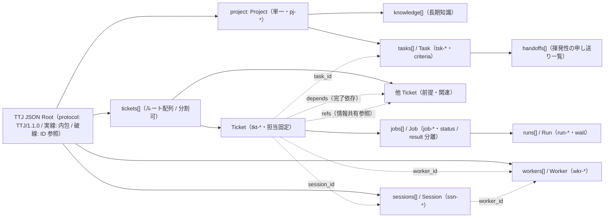

# TTJ

**Task–Ticket–Job 管理規格 · v1.1.0**

- [定義] **目的**：担当や環境が変わっても、作業・申し送り・知識を安全に継続する。
  - [必須] Worker 種別（人間・Bot・AI 等）で業務ロジックや状態遷移を分岐させず、特定 Agent・Bot・オーケストレーターへ依存しない。
  - [必須] 必要な情報を一度だけ書き、不要な分類や状態機械を増やさない。

- [必須] **規格の識別**：独立した JSON 文書のルートに `protocol: "TTJ/1.1.0"` を持つ。
  - [定義] 子レコードは同じ版を共有し、転記は不要。
- [必須] **Task / Ticket 分離構造の単一 JSON スキーマと配列・単一オブジェクトの原則（ファイル分割対応）**：0〜複数があり得る項目（`workers`, `sessions`, `knowledge`, `tasks`, `tickets`, `jobs`, `runs` 等）のみ配列（空配列 `[]`・1要素 `[ {...} ]`・複数要素 `[ {...}, {...} ]` のいずれも許容し、空配列時は記載省略可）とし、1つだけに定まっている項目（ルートの `project`、`Run.wait`）は配列にせず単一オブジェクト（未記載時は省略可）とする。JSON 文書のルートは `protocol`（必須）・`workers`・`sessions`・`project`・`tickets` の5キーのみとし、Project / Task 階層は単一オブジェクト `project` 配下の `project.tasks[]`（および `project.knowledge[]`・`project.tasks[].handoffs`。`Task` 内に `tickets` は持たない）、Ticket 以下の作業階層はルート直下の `tickets[].jobs[].runs[]`（各 `Ticket` は親 Task を指す `task_id` 必須）に分離・統一する（親要素の内側に置かれる `Task.project`・`Handoff.task_id` 等の逆参照や、`Ticket.jobs` の ID 配列／実体分離は持たない）。この省略規則により、100% 同一のルート JSON スキーマのまま、Task 側の管理ファイル（`protocol` と単一オブジェクト `project` 等のみを記載し `tickets` は省略）とチケット単位の分割ファイル（`protocol` と `tickets` のみを記載し `project` 等は省略）に分けて排他操作する運用と、1ファイルにまとめる運用の双方に対応する。
- [必須] **ID 自動採番形式**：Project・Task・Ticket・Job・Run の ID は `<接頭辞>-<英数字6桁または8桁>-<正の連番>` とする。新規 Worker は `wkr-<固有の英数字9桁>`、新規 Session は `ssn-<Worker ID>-<Worker 内の正の連番>` とする。連番は1始まりで先頭にゼロを付けない。例は `wkr-01234abcd` と `ssn-wkr-01234abcd-10`。既存の Worker・Session ID は保持する。
- [必須] **Worker と Session**：作業の責任主体（`Worker`：`id`（接頭辞 `wkr-`）・`name`）と実行単位（`Session`：`id`（接頭辞 `ssn-`）・`worker_id`）を分離する。
  - [禁止] `owner_type` の必須化や、Worker 種別による状態遷移の分岐。
  - [必須] 単一 Owner 原則により Project / Task の状態の最終確定者を単一 Owner に固定する。
- [必須] **Project**：ルートの単一オブジェクト `project` として `id`（接頭辞 `pj-`）と意味の分かる `name` を持つ（任意で `knowledge`・`tasks` を保持）。
  - [任意] リポジトリを伴わない作業にも使う。
- [定義] **目標**：`objective` は Task・Ticket・Job で同じ意味の「達成したいこと」。
- [必須] **Task**：`project.tasks[]` の要素として `id`（接頭辞 `tsk-`）・`objective`・`criteria` を持つ長寿命の成果目標（任意で `status`・`deadline`・`resume`・`handoffs` を保持。`tickets` はルート直下の `tickets[]` に分離されるため `Task` 内には持たない）。
  - [任意] 期限がある場合だけ `deadline` をタイムゾーン付き ISO 8601 日時で記載する。
  - [禁止] 修正・再実行による Ticket 増加で Task を増殖させる、または完了 Ticket 数のみで達成率を決める。
- [必須] **Ticket**：ルート `tickets[]` の要素として `id`（接頭辞 `tkt-`）・`task_id`（所属する親 Task の ID `tsk-*`）・`worker_id`・`session_id`・`objective`・`jobs`（`Job` オブジェクトの配列、空配列時は省略可）を持つ、単一 Worker・単一 Session 担当・一方向進行の作業単位。
  - [任意] その Ticket でやらないこと（対象外・除外事項）を `exclusions`（文字列の配列、空配列時は省略可）に明記して認識すり合わせ精度を高め、実行時は対象外作業を行わない（`Job` には置かない）。
  - [禁止] 複数担当、Job ごとの個別担当、同一 Ticket の `worker_id`・`session_id` 変更、Ticket 独自の `criteria`、終端 Ticket の再開。Job 列の追加はレビュー差し戻し受領時の一括末尾追加に限る。
  - [必須] 担当 Session が再開不可になった場合は、旧 Ticket を中止（`canceled` と `cancel_reason` を記録）して閉じ、同一 Task（同じ `task_id`）に紐づく `refs` 付きの新規 Ticket を起票して新しい Session（`ssn-*`）で稼働させる。
  - [必須] 全 Job が `completed` または `canceled` になれば `completed` に集約し、Ticket 自身がキャンセル済みなら `canceled` と `cancel_reason` を維持する。
  - [定義] 次 Ticket が未作成でも終了済み Ticket をアーカイブできる。
- [必須] **Job**：`tickets[].jobs[]` の要素として `id`（接頭辞 `job-`）・`objective`・`criteria`（任意で `instructions`・`status`・`result`・`artifacts`・`resume`・`runs`）を持つ最小実行単位。
  - [必須] 進行状態 `status` と業務結果 `result`（`approved`・`changes_requested`・`passed`・`failed` 等）を分離する。
  - [禁止] 独立した `Request` オブジェクト、子 Job、複雑なワークフロー構造、種別ごとの Job 分類。
- [任意] **実行依存と情報共有参照**：実行依存 `depends`（循環禁止）と、成果物・中止理由・派生関係等を共有する `refs` を明確に区別する。
- [定義] **Run**：`tickets[].jobs[].runs[]` に任意で保持するコマンド実行試行の正本（未実行等の空配列時は省略可）。`id`（接頭辞 `run-`）・開始時刻（`started`）・終了時刻（`ended`）・試行結果（`result`）・待機制御（`wait`）を保持する（実行中は `result`・`ended` が無く、終了確定時に `result` と確認できれば `ended` を記録する）。
  - [必須] 同一 Ticket・同一 Session 内での Job 再試行は、失敗した旧 Run を閉じて当該 Job の `runs` 配列に新しい Run を追加・実行する。
  - [必須] 前の実行が停止（または残存副作用がない安全条件）していることを確認した上で旧 Run と旧 Ticket を閉鎖した場合のみ、新規 Ticket への引き継ぎを許可する。
- [定義] **揮発性 Handoff と長期知識**：短期の引き継ぎは Task 内側の揮発性の申し送り一覧 `handoffs`（`project.tasks[].handoffs`、Task 完了時に消去）、長期知識は Project の `knowledge`（`project.knowledge[]`：`active`・`supersed`）に分ける。
  - [必須] Handoff 消失でも正式履歴を失わず、無関係な Ticket の並列実行を遮らない。
- [定義] **[規格本文](skills/ttj/references/specification.md)**：TTJ v1.1.0 作業規則の正本。
- [定義] **[JSON参照形式](skills/ttj/references/json-format.md)**：項目ごとの記入方法と例。
- [定義] **[代表ユースケースとサンプルパターン（UC-01〜UC-10）](skills/ttj/references/use-cases.md)**：代表的な10場面における状態遷移と JSON サンプルパターン。
- [定義] **[TTJ Skill](skills/ttj/SKILL.md)**：LLM が規格を適用する手順。
  - [任意] `skills/ttj` 全体を利用環境の Skill 配置先へコピーする。
  - [必須] コピーする場合は参照文書も含める。
  - [禁止] Skill 単独で永続化・排他・外部副作用防止を保証したと称する。
- [定義] **[v1.1.0 変更点](docs/migration-1.1.0.md)**：TTJ 1.0.0 から 1.1.0 への追加・削除・変更点の一覧。
- [定義] **ライセンス**：[Apache-2.0](LICENSE)。
